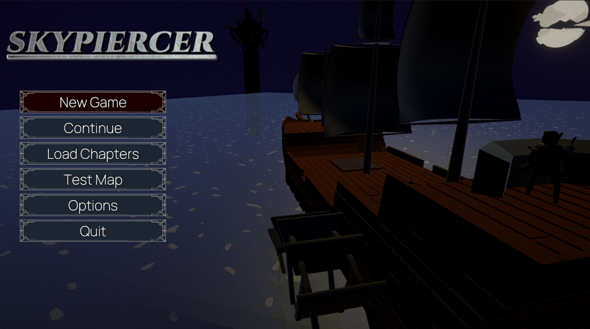

# Skypiercer

Skypiercer is a turn-based tactical RPG inspired by Fire Emblem, featuring strategic combat, more than a hundred skills, battalion mechanics, and a story-driven campaign set in a world shaped by an apocalyptic cataclysm.

## Story

Follow *Zack Farron* and his allies as they travel the world in the midst of a terrifying war. What begins as a local incident escalates into a journey beyond their isolated village to stop Caelum, a force plotting to take over the world.

## Game Mechanics

### Characters

Each character has their own stat and growth rates (which corresponds to the odds of a stat increasing when levelling up). Thay also all have their own passive skill, which gives them stat boosts or new abilities. This skill levels up at certain character level thresholds.

### Blades

Characters can summon their weapons (Blades). Blades are all one of 8 types which all have different stats and effect in combat. Using a blade allows the character to increase the level of said blade type, which increases their stats, but reduces their maximum durability.
Each character (except Zack, the main character) has access to 3 different blade type, which allows different play style for each character.
When levelling up, growth rates are influenced by the weapon the character is holding (each weapon increases 2 growths and decreases 1).

### Telekinesis

Characters can toggle Telekinesis, which increases their attack range by one, change the stat for damage calculation (from Strength and Defense to Psyche and Resistance), which gives every character a potential ranged option.

### Battalion and examode

Characters can be assigned to the battallion of of one the three protagonist once they are unlocked. Being assigned to a battallion gives passive bonuses to both the unit and the leader.

After reaching a certain point in the story or complaining certain side missions, protagonists gain access to examode, which is a temporary overpowered state. It's effects differ for each protagonist, but they always empower both them and the units in thei battallion. The examode gauge fills up when the unit or their subordinates take action.

### Skills

Characters can equip skills to give them new abilities or stat bonuses.
Each character has two personnal skills that cannot be changed or deactivated (the second one is sometimes unavailable when getting the character and are unlocked when completing certain missions). These skills level up with the character.
Each character has 4 slots in which Skills of the player's choice can be equiped. Skills can be obtained either by stealing them from enemies or by buying them at a shop accessible between each battle.
A skill can be bought once it has been seen on an enemy during a mission.

### Tile effects

In a mission, tiles in which character can have varrying effects. Some are permanent, like the tile being a forest, a ruin, or a desert while some effects may change as the mission unfolds.
One such change is weather. On maps when it is taken into account, tiles can be either rainy, cloudy or sunny. Weather can change depending on the weather of nearby tiles. It can gives bonuses or maluses to units and interract with skills.
Some maps have also different levels of elevations, which has an influence on hit rate and movement costs.

## Advancement

As of version 0.22.0, there are:
- 18 Story maps
- 4 Side Story Maps
- 17 Different Characters
- 119 Differents Skills

## Credits

Game design, concept, 3D Models and code by Riki.

Music by <a href="https://maou.audio/category/bgm/"> Maoudamashii </a> and<a href="https://youfulca.com/en/music_assets/"> Youfulca </a> 

Icons by xoraki_rkd

Placeholder images borrowed from Fire Emblem Awakening and Fire Emblem Echoes, Shadows of Valentia (I do not own these images).

## Controls

(for Xbox Controller and AZERTY keyboard)

- Movement  : left stick / ZQSD
- Camera : right sitck  / Arrow Keys
- Reset Camera : press right stick / tab
- Validate : A / K
- Cancel : B / escape (or L)
- See Skill Details : X / I
- Activate (or deactivate) telekinesis : Y / O
- Next Target (resp previous) RT (LT) / 0 (1)
- Next Weapon (resp previous) RB (LB) / P (A)
- Show/Hide Dangerous Tiles D-pad Up / Right Maj
- Show Weather Tiles D-pad Left / 2
- Activate Examode D-pad Down / 3
